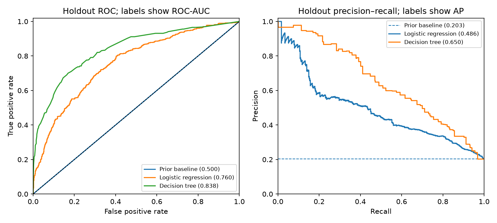

# Bank Customer Churn Analysis

A reproducible educational comparison of logistic regression, a decision tree, and a prior-probability baseline on the original 10,000-row Churn Modelling benchmark. The analysis emphasizes positive-class recall, class imbalance, and correctly calculated probability-ranking metrics.

This coursework benchmark is independent of any employer or client records. It is not a deployed bank retention system or evidence of measured financial benefit.

## Method

- Select an explicit contract of eight numeric and two categorical predictors. Exclude IDs, surnames, the target, and notebook-derived artifacts.
- Reserve a fixed stratified 20% holdout with seed 0 before fitting any learned preprocessing.
- Put median/mode imputation, one-hot encoding, MinMax scaling, and the classifier inside a scikit-learn Pipeline. Five stratified folds on the training partition refit that entire pipeline.
- Search six logistic-regression and twelve decision-tree configurations. Select by probability-based average precision on training folds, with no holdout-driven threshold tuning.
- Evaluate both selected models and a prior baseline once on the fixed holdout. Report precision, recall, F1 and balanced accuracy at threshold 0.5, plus separate probability-based ROC-AUC and average precision.

The tree search is deliberately modest: depths 3/5/8, minimum leaf sizes 10/30, and optional balanced class weights. The logistic search uses valid liblinear/L2 configurations, three C values, and optional balanced class weights. Changing class weights can change the precision–recall tradeoff; it is not a free improvement in all metrics.

## Run

Python 3.12 is the validation target. Create and activate a virtual environment, then run from the repository root:

```bash
python -m pip install -r requirements.txt
python src/analyze.py --data data/Churn_Modelling.csv --output results
python -m unittest discover -s tests -v
```

Acquire the original benchmark from its [Kaggle Churn Modelling listing](https://www.kaggle.com/datasets/shrutimechlearn/churn-modelling); [data/README.md](data/README.md) documents the required file and schema. Raw CSVs are not committed. The analysis makes no network requests.

[notebooks/analysis.ipynb](notebooks/analysis.ipynb) runs the same module and displays aggregate metrics and curves in a Jupyter-compatible editor.

## Verified results

<!-- VERIFIED_RESULTS_START -->
Validated on **10,000 original benchmark rows**, with 8,000 training and 2,000 held-out observations. The test partition has 20.35% positive cases; metrics below use the final fixed holdout.

| Model | Accuracy | Positive precision | Positive recall | Positive F1 | ROC-AUC | Average precision |
|---|---:|---:|---:|---:|---:|---:|
| Prior baseline | 0.7965 | 0.0000 | 0.0000 | 0.0000 | 0.5000 | 0.2035 |
| Logistic regression | 0.8125 | 0.6739 | 0.1523 | 0.2485 | 0.7600 | 0.4861 |
| Decision tree | 0.8480 | 0.6846 | 0.4693 | 0.5569 | 0.8377 | 0.6498 |

Training-only AP selected logistic C=0.1 without class weighting, and a depth-8 tree with minimum leaf size 30 without class weighting. The corrected logistic model's recall is **lower than the historical 31.45% figure**; changed preprocessing and selection mean these are different procedures. Both results remain visible, and the holdout was not retuned to improve that number. The tree gives a stronger result on this specific split, not evidence of a production bank benefit.

Three focused tests passed. All three notebook code cells completed by sequential IPython execution in the validation interpreter, with one actual embedded chart and zero error outputs. A separate Jupyter-kernel launch did not complete in the bounded validation attempt; no successful kernel-server run is claimed. See [results/validation.json](results/validation.json) for the exact scope and versions.


<!-- VERIFIED_RESULTS_END -->

`results/summary.json` records the data fingerprint, split, feature contract, environment, chosen parameters, confusion matrices, and both ranking metrics. `training_cv_comparison.csv` contains training-fold search evidence. No individual customer rows, IDs, names, or predictions are exported.

## Historical results and corrections

The original notebook's saved logistic model reported 83.55% accuracy and 31.45% positive recall, showing why accuracy alone can hide missed churn cases. Its displayed “AUC 36.57%” was average precision calculated from hard class labels, not ROC-AUC. That historical value cannot be compared directly with the corrected probability-based AP or ROC-AUC.

The original source already dropped `#`, `CustomerId`, and `Surname`; this repository preserves that behavior. The actual repairs move learned preprocessing inside the training/CV pipeline, exclude later derived artifacts, remove incompatible search combinations and deprecated tree options, and complete a bounded tree comparison. See [docs/METHODOLOGY_CHANGES.md](docs/METHODOLOGY_CHANGES.md).

## Limitations

- A random split of a teaching benchmark is not a prospective, temporal, or external bank evaluation.
- Collection provenance, representativeness, and the generating institution were not independently verified.
- Threshold 0.5 is a transparent fixed default, not a bank-specific cost optimum. No retention-cost or causal-impact claim is made.
- No repeated outer validation, calibrated risk estimate, subgroup fairness study, or deployment monitoring is established.
- Raw data is omitted because redistribution terms were not independently established; acquisition remains through the publisher's source page.

## Credits and license

Prepared for Ginno D. Arostique Jr. from his existing churn-modeling exercise, with a corrected publication refactor. Dataset source listing: `shrutimechlearn`, Kaggle. Model and preprocessing implementations use scikit-learn.

The MIT license covers the newly prepared personal source, notebook wrapper and documentation only. It does not relicense external benchmark data or third-party packages.
